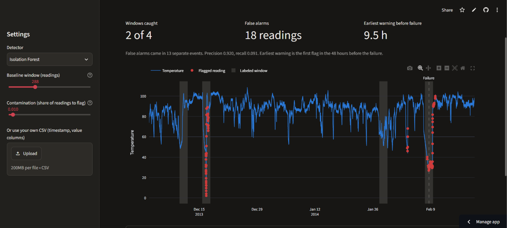

# Sensor Anomaly Detector

A web app that looks for warning signs of a machine failure in real industrial temperature data. It compares two detectors, a rolling z-score and an Isolation Forest, and grades them against the known anomaly periods.

I built this as a learning project to practice deploying a machine learning app.

**Live app:** https://sensor-anomaly-detector-j48h2f.streamlit.app/



## What it does

- Plots the temperature over time, with the labeled anomaly windows shaded and flagged readings in red.
- Lets you pick a detector and adjust its settings with sliders.
- Shows how many windows were caught, how many false alarms there were, and how early the detector warned before the failure.
- Lets you upload your own CSV with `timestamp` and `value` columns. Uploaded files have no labels, so the app shows how many readings were flagged but can't score them.

## How to run it locally

You need Python 3.13.

```
git clone https://github.com/Kerem-Oncer/sensor-anomaly-detector.git
cd sensor-anomaly-detector
python -m venv .venv
.venv\Scripts\activate
pip install -r requirements.txt
streamlit run app.py
```

On Mac or Linux, activate the environment with `source .venv/bin/activate` instead.

To print the results without the web app, run `python detector.py`.

## How the detectors work

**Z-score:** compares each reading to the average of the readings before it, and flags it if it's too many standard deviations away. It only looks backward, so it could run on a live stream.

**Isolation Forest:** builds random trees that keep splitting the data, and flags the readings that get separated fastest. It's unsupervised, so it never sees the labels. They're only used to grade it.

## Results

Both detectors use a 24-hour baseline (288 readings).

| Metric | Z-score (threshold 4) | Isolation Forest (contamination 0.01) |
|---|---|---|
| Windows caught | 2 of 4 | 2 of 4 |
| False alarm readings | 241 | 18 |
| False alarm events | 36 | 13 |
| Precision | 0.207 | 0.920 |
| Recall | 0.028 | 0.091 |
| Earliest warning before failure | 30.9 hours | 9.5 hours (2.4 to 9.5 across random seeds) |
| Chance a random 47-hour stretch outside the windows has a flag | 50.0% | 4.5% |

- **Isolation Forest is much more precise.** It rarely flags outside the windows, so its catches are unlikely to be luck.
- **The z-score detector warns earlier.** It flags the sudden drop about 31 hours before the failure, but it also raises many more false alarms.
- **Both miss the same two windows.** Neither catches windows 1 or 3 at these settings. Raising contamination to 0.05 catches all four, with 287 false alarm readings.

### Why not accuracy?

Anomalies are rare, so accuracy is meaningless. About 90% of the rows are outside the labeled windows, so a detector that never flags anything would score about 90% and still miss every failure.

### What the metrics mean

- **Windows caught:** labeled windows with at least one flag inside.
- **False alarms:** flagged readings outside the windows. An event is one unbroken run of them.
- **Precision:** the share of flagged readings that were inside a window.
- **Recall:** the share of readings inside the windows that got flagged. It stays low because the windows are about 47 hours long and most of that time looks normal.
- **Earliest warning:** the first flag in the 48 hours before the failure, inside a window or not. This means it can't go above 48 hours, and at low thresholds it hits that limit because something is nearly always flagged.

## Limitations

- **One failure:** the data has a single catastrophic failure, so the warning times are one example and don't show how the detectors would do on other failures.
- **Which window is the failure:** NAB lists three anomalies but labels four windows, and doesn't say which is which. Treating the last window as the failure is my own reading of the data.
- **Isolation Forest has seen the future:** it trains on the whole file, including the failure, so it couldn't run live as written. This also makes the comparison with the z-score detector not quite fair. A real system would train on past data only.
- **Isolation Forest's warning time is unstable:** it ranged from 2.4 to 9.5 hours across four random seeds, so it's only a rough figure.
- **The z-score threshold isn't an independent test:** I set the default of 4 after seeing how each threshold scored against the labels, so those results are probably a little optimistic. There's no separate test set.
- **Real warnings can count as false alarms:** the temperature starts falling before the failure window opens. Flags on that drop count as false alarms because I kept NAB's labels unchanged.
- **Repeated timestamps:** on 2014-01-07 the clock jumps back 55 minutes, so 12 timestamps appear twice. The app sorts by time and keeps both readings.

## Data credit

The data comes from the [Numenta Anomaly Benchmark (NAB)](https://github.com/numenta/NAB), Copyright 2014-2024 Numenta Inc., which is available under the [MIT License](https://github.com/numenta/NAB/blob/master/LICENSE.txt). This project uses `realKnownCause/machine_temperature_system_failure.csv` and the windows from `labels/combined_windows.json`, both unchanged, in the `data/` folder. A copy of NAB's license is in `data/LICENSE-NAB.txt`.
